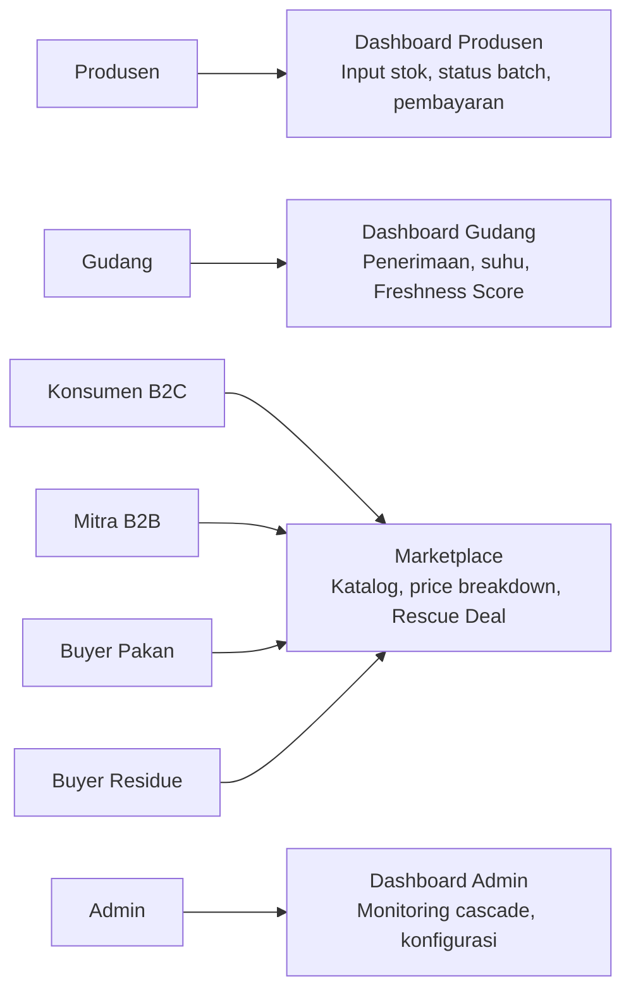

# 👥 7 Peran Pengguna

Sistem melayani **tujuh peran** dalam satu ekosistem data:

| #   | Peran                                  | Aktivitas Utama                                           | Kebutuhan Utama                 |
| --- | -------------------------------------- | --------------------------------------------------------- | ------------------------------- |
| 1   | **Produsen** (petani/supplier)         | Input stok, tanggal panen, harga dasar; pantau pembayaran | Harga adil, kepastian penjualan |
| 2   | **Gudang**                             | Cek kualitas, catat suhu, update status batch             | Data kesegaran akurat           |
| 3   | **Konsumen B2C**                       | Beli harga normal, ikut Rescue Deal sesuai tier           | Harga terjangkau, bahan segar   |
| 4   | **Mitra B2B** (resto, hotel, katering) | Order besar, pre-order, ikut Rescue Deal                  | Harga stabil, sertifikat dampak |
| 5   | **Admin Platform**                     | Kelola tier, harga dasar, monitoring cascade              | Kontrol dan audit               |

## Dashboard per Peran

## Halaman Publik (Tanpa Login)
- **Impact Counter** — kg terselamatkan, CO₂e, WDR
- **QR Traceability** — `/trace/[batchId]`

---

## Lihat Juga
- [[📋 Ringkasan Produk]]
- [[🏅 Loyalty Tier System]]
- [[🏠 Home]]
