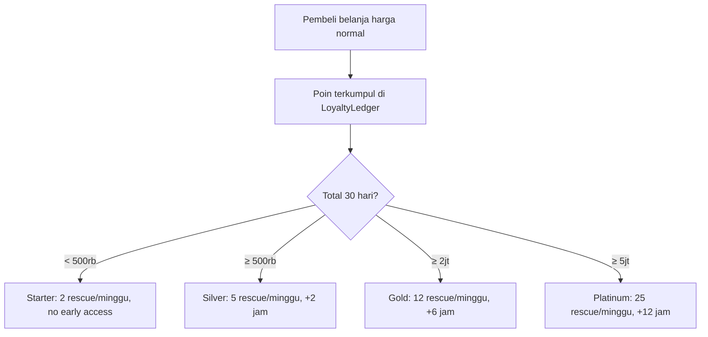

# 🏅 Loyalty Tier System

## Tujuan

Mencegah **strategic waiting** — pembeli yang sengaja menunggu barang hampir expired demi harga murah, sehingga merugikan penjualan harga normal.

## Mekanika

Tier ditentukan berdasarkan **total belanja harga normal selama 30 hari terakhir**.

| Tier | Syarat Belanja Normal 30 Hari | Kuota Rescue/Minggu | Early Access |
|------|-------------------------------|---------------------|-------------|
| ⚪ Starter | < Rp500.000 | 2 item | Tidak ada |
| 🥈 Silver | ≥ Rp500.000 | 5 item | +2 jam |
| 🥇 Gold | ≥ Rp2.000.000 | 12 item | +6 jam |
| 💎 Platinum | ≥ Rp5.000.000 | 25 item | +12 jam |

## Anti-Abuse Rules

- Kuota rescue **tidak bisa di-stack** antar minggu
- Poin hanya dari **pembelian harga normal** (bukan rescue)
- Early access timer **strict** — jika tier-mu belum waktunya, kamu belum bisa akses

## Flow

## Tabel Database Terkait
- `buyer_tiers` — status tier saat ini
- `buyer_loyalty_ledger` — riwayat belanja & poin
- `rescue_quota_usage` — tracking kuota terpakai

---

## Lihat Juga
- [[💰 Dynamic Rescue Pricing]]
- [[🗄 Database Schema]]
- [[🔌 API Endpoints]] — `/tiers/me`
- [[🏠 Home]]
