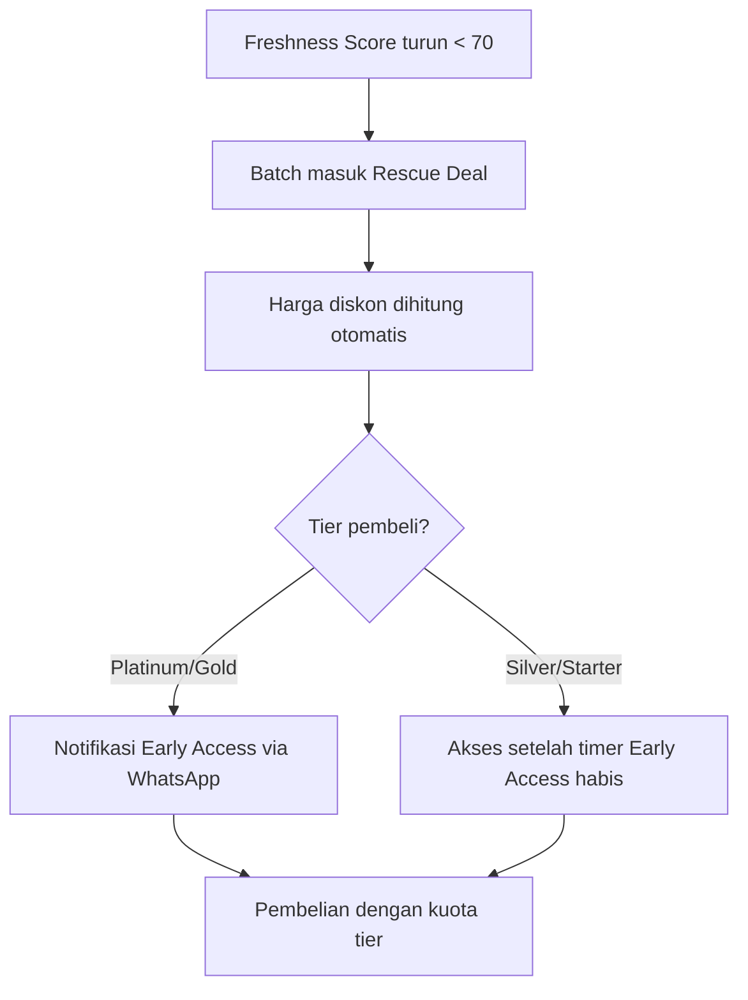

# 💰 Dynamic Rescue Pricing

## Konsep

Ketika [[🧪 Freshness Score]] sebuah batch turun di bawah threshold tertentu, batch tersebut **otomatis masuk Rescue Deal** dengan harga diskon yang meningkat seiring penurunan skor.

## Cara Kerja

## Aturan Pricing

- Diskon **gradual**, bukan diskon besar di akhir
- Semakin rendah skor → semakin besar diskon (hingga ~60%)
- Bukan model "tunggu sampai expired lalu diskon"
- Mendorong pembelian di skor yang masih layak

## Integrasi

- Terikat dengan [[🏅 Loyalty Tier System]] — akses rescue dibatasi berdasarkan tier
- Notifikasi deal dikirim via **Fonnte WhatsApp** (sandbox)
- Pembayaran via **Midtrans Sandbox**

---

## Lihat Juga
- [[🧪 Freshness Score]]
- [[🏅 Loyalty Tier System]]
- [[🔌 API Endpoints]] — `/deals`
- [[🏠 Home]]
