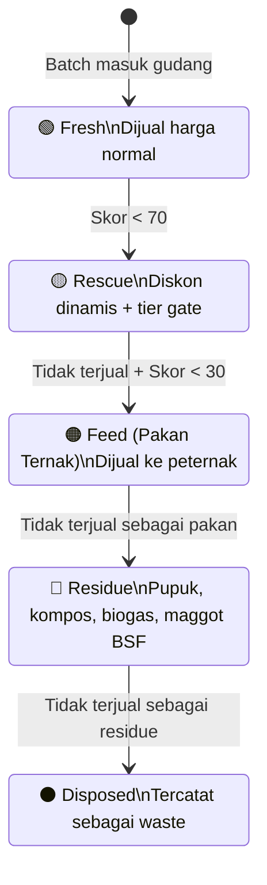

# 🔄 Cascade State Machine

## Konsep

Setiap batch melewati **5 tahap** — tidak ada yang langsung dibuang. Setiap tahap memiliki marketplace dan pembeli sendiri.

## Diagram Cascade

## Tahapan Detail

| Tahap | Pembeli | Marketplace | Harga |
|-------|---------|-------------|-------|
| **FRESH** | B2C, B2B | Marketplace utama | Harga normal |
| **RESCUE** | B2C, B2B (sesuai tier) | Rescue Deal | Diskon dinamis s/d 60% |
| **FEED** | Buyer pakan ternak | Marketplace Pakan | Per kg, harga rendah |
| **RESIDUE** | Pengolah pupuk/kompos/biogas | Marketplace Residue | Per kg, harga sangat rendah |
| **DISPOSED** | — | — | Tercatat di Impact Ledger |

## Transisi & Audit

- Setiap transisi dicatat di tabel `cascade_events` dengan timestamp, pelaku, dan alasan
- Timer per tahap bisa dikonfigurasi admin
- **Simulate Time** memungkinkan percepatan untuk demo

## Metrik Keberhasilan

**Waste Diversion Rate (WDR):**
$$WDR = \frac{\text{Batch yang TIDAK berakhir DISPOSED}}{\text{Total batch}} \times 100\%$$

---

## Lihat Juga
- [[🧪 Freshness Score]]
- [[🌍 Impact Ledger]]
- [[🗄 Database Schema]] — `cascade_events`, `feed_listings`, `residue_listings`
- [[🏠 Home]]
