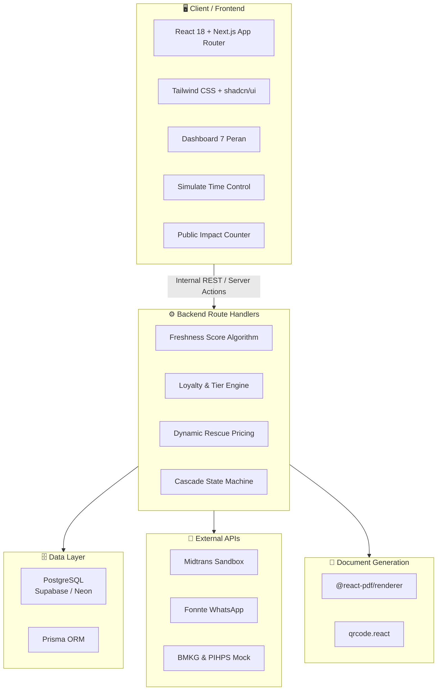

# 🏗 Arsitektur & Tech Stack

## Arsitektur: Next.js Fullstack (Opsi A)

Single repository / monorepo — Frontend UI dan Backend API dalam satu codebase.

**Keuntungan:**
- Tidak perlu konfigurasi CORS
- Tidak perlu autentikasi beda domain
- Tidak perlu deployment ganda

## Diagram Arsitektur

## Rincian Tech Stack

| Layer | Teknologi | Fungsi & Alasan |
|-------|-----------|----------------|
| **Framework** | Next.js 14+ (App Router) | Fullstack, rendering tercepat, API Route terintegrasi |
| **Language** | TypeScript | Type safety dari DB hingga UI |
| **UI** | Tailwind CSS + shadcn/ui | Komponen accessible & profesional siap pakai |
| **Database** | PostgreSQL (Supabase / Neon) | Cloud relational DB untuk 15+ tabel |
| **ORM** | Prisma | Query builder, auto-migration, autogenerate TS types |
| **Auth** | Supabase Auth / NextAuth.js | RBAC untuk 7 peran |
| **PDF** | @react-pdf/renderer | Sertifikat Impact ESG via JSX |
| **QR Code** | qrcode.react | QR traceability per batch |
| **Payment** | Midtrans Sandbox | Simulasi pembayaran |
| **Notifikasi** | Fonnte WA Sandbox | WhatsApp notification |
| **Deployment** | Vercel | CD otomatis dari GitHub |

---

## Lihat Juga
- [[🗄 Database Schema]]
- [[🔌 API Endpoints]]
- [[🎭 Strategi Demo]]
- [[🏠 Home]]
