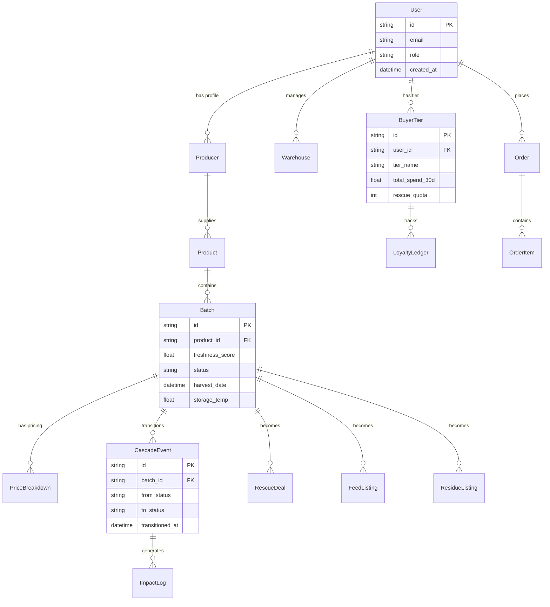

# 🗄 Database Schema

## Overview

15+ tabel PostgreSQL dikelola via **Prisma ORM**. Dikelompokkan dalam 8 domain:

## ERD Diagram

## Detail per Domain

### 1. User & Auth
| Tabel | Keterangan |
|-------|-----------|
| `users` / `accounts` | Credentials, role (7 peran), profil |

### 2. Supply Chain
| Tabel | Keterangan |
|-------|-----------|
| `producers` | Profil produsen (petani/supplier) |
| `warehouses` | Lokasi penyimpanan gudang |

### 3. Produk & Batch
| Tabel | Keterangan |
|-------|-----------|
| `products` | Katalog bahan pokok, shelf life per komoditas |
| `batches` | Tanggal panen, suhu simpan, `freshness_score`, status |

### 4. Pricing
| Tabel | Keterangan |
|-------|-----------|
| `price_breakdowns` | Harga dasar petani, biaya gudang, logistik, margin |

### 5. Loyalty
| Tabel | Keterangan |
|-------|-----------|
| `buyer_tiers` | Status tier saat ini |
| `buyer_loyalty_ledger` | Total belanja 30 hari, poin |
| `rescue_quota_usage` | Kuota rescue terpakai per minggu |

### 6. Rescue
| Tabel | Keterangan |
|-------|-----------|
| `rescue_deals` | Listing diskon dinamis + timer early access |

### 7. Cascade
| Tabel | Keterangan |
|-------|-----------|
| `cascade_events` | Audit log transisi status |
| `feed_listings` | Katalog pakan ternak |
| `feed_buyers` | Pembeli pakan |
| `residue_listings` | Katalog pupuk/biogas |
| `residue_buyers` | Pembeli residue |
| `residue_sales` | Transaksi residue |

### 8. Transaksi & Dampak
| Tabel | Keterangan |
|-------|-----------|
| `orders` | Transaksi pembelian semua tahapan |
| `order_items` | Detail item per order |
| `impact_logs` | kg terselamatkan, CO₂e, air dihemat |

---

## Lihat Juga
- [[🏗 Arsitektur & Tech Stack]]
- [[🔌 API Endpoints]]
- [[🧪 Freshness Score]] — rumus yang menggunakan data batch
- [[🏠 Home]]
