# ⏱ Timeline Sprint 8 Hari

## Visualisasi Timeline

```mermaid
flowchart LR
    subgraph D87["H-8 & H-7: FONDASI"]
        A1["Setup Next.js + TS + Tailwind + shadcn"]
        A2["Prisma Schema 15+ tabel"]
        A3["Auth & Role Seeding"]
        A4["Mock Data Seeding"]
    end
    
    subgraph D65["H-6 & H-5: LOGIK INTI"]
        B1["CRUD Batch & Gudang"]
        B2["Freshness Score Algorithm"]
        B3["Dynamic Rescue Pricing"]
        B4["Simulate Time API"]
        B5["Marketplace B2C & B2B"]
    end
    
    subgraph D43["H-4 & H-3: TIER & CASCADE"]
        C1["Loyalty Tier System"]
        C2["Early Access Timer"]
        C3["Cascade: FEED & RESIDUE"]
        C4["WhatsApp Notification"]
    end
    
    subgraph D2["H-2: TRANSPARANSI"]
        D1["Impact Counter Public"]
        D2x["QR Traceability"]
        D3["Price Breakdown"]
        D4["PDF Sertifikat ESG"]
    end
    
    subgraph D1x["H-1: POLISH"]
        E1["Integration Testing"]
        E2["Deploy Vercel + Supabase"]
        E3["Skenario Demo Juri"]
        E4["🔒 Freeze Code"]
    end
    
    D87 --> D65 --> D43 --> D2 --> D1x
```

## Detail per Hari

### H-8 & H-7: Fondasi & Database
- [ ] Setup Next.js App Router + TypeScript + Tailwind + shadcn/ui
- [ ] Inisialisasi Prisma ORM Schema (15+ tabel)
- [ ] Setup Auth & Role Seeding (7 peran)
- [ ] Mock Data Seeding (komoditas, shelf life, pasokan awal)

### H-6 & H-5: Logik Inti & Engine
- [ ] CRUD Batch Pasokan & Gudang
- [ ] Algoritma Freshness Score + kalkulasi
- [ ] Dynamic Rescue Pricing
- [ ] Endpoint `/api/demo/simulate-tick`
- [ ] Marketplace Katalog B2C & B2B

### H-4 & H-3: Tier, Cascade & Marketplace
- [ ] Sistem Loyalty Tier + kalkulasi poin
- [ ] Kuota & Anti-Abuse Rules
- [ ] Early Access Timer berdasarkan Tier
- [ ] Transisi Cascade (FEED & RESIDUE Marketplace)
- [ ] WhatsApp Gateway (Fonnte Sandbox)

### H-2: Transparansi & Impact
- [ ] Halaman Impact Counter Public + WDR
- [ ] Halaman Traceability via QR Code
- [ ] Price Breakdown Visualizer
- [ ] PDF Generator Sertifikat ESG

### H-1: Polish & Deploy
- [ ] Integration Testing alur A-Z
- [ ] Deploy ke Vercel & Supabase Cloud
- [ ] Skenario presentasi demo juri
- [ ] 🔒 **Freeze Code**

---

## Lihat Juga
- [[📋 Kanban Board]]
- [[🎭 Strategi Demo]]
- [[🏠 Home]]
