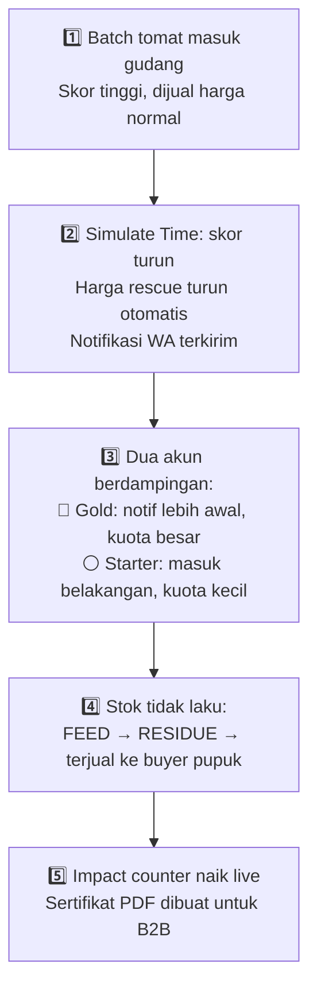

# 🎭 Strategi Demo

## A. Engine "Simulate Time"

**Masalah:** Penurunan Freshness Score dan transisi cascade butuh waktu hari/jam — terlalu lama untuk demo.

**Solusi:** Tombol **"Simulate Time"** di header UI memicu API `/api/demo/simulate-tick`:
1. Majukan `simulated_current_time` di database (+24 jam per klik)
2. Hitung ulang [[🧪 Freshness Score]] semua batch
3. Batch yang melewati threshold otomatis transisi cascade

## Skenario Demo untuk Juri

## B. Fallback API Eksternal

**Masalah:** API BMKG / harga pasar bisa rate-limit atau down saat presentasi.

**Solusi:**
- Bungkus panggilan API dengan **timeout 1.5 detik**
- Jika gagal → otomatis ambil dari `fallback-data.json`
- Juri tidak akan melihat error

## C. WhatsApp & Payment Sandbox

- **WhatsApp:** Daftarkan nomor demo ke Fonnte Sandbox → notifikasi terkirim ke HP nyata
- **Pembayaran:** Midtrans Snap mode Sandbox → pop-up pembayaran tanpa uang asli

> [!IMPORTANT]
> Pastikan data dummy realistis dan skenario demo dipraktekkan minimal 2x sebelum presentasi.

---

## Lihat Juga
- [[⏱ Timeline Sprint 8 Hari]] — H-1 Polish & Dry-run
- [[⚠️ Risiko & Mitigasi]]
- [[🏠 Home]]
